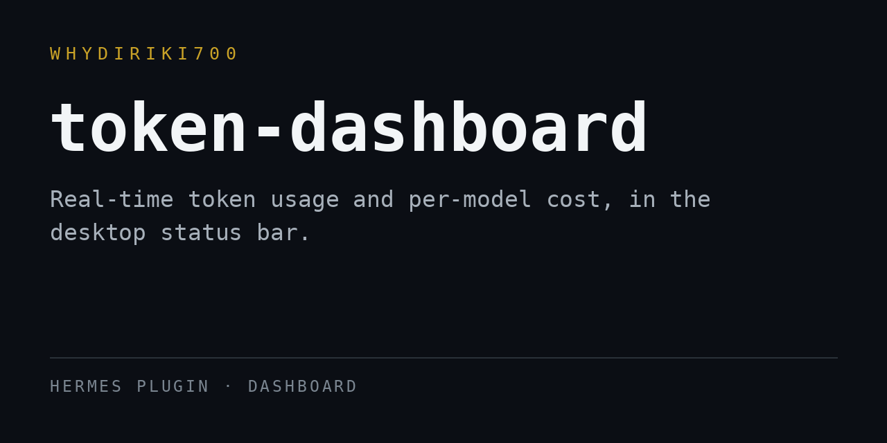

# Token Dashboard

**See what your focused session actually costs, while it works.**

A Hermes Desktop plugin that turns the live usage stream into a cost dashboard: a right-hand pane with the focused session's token counts, estimated cost, model and reasoning effort, API calls, session elapsed time, a turn timer for the task in progress, and context usage with an optional compression-threshold mark, a status bar chip that keeps the running session cost always visible, and an overview of your recent sessions.

> **Status:** Submitted to the official Hermes plugin catalog ([NousResearch/hermes-agent#149187](https://github.com/NousResearch/hermes-agent/pull/149187), merged). Built for the Hermes Agent Plugin Hackathon; the demo was recorded from a real Hermes session.

## Features

* Live input and output token counts for the focused session, streamed from the backend (no polling of usage data)
* Live session elapsed time for the focused session, ticking every second, with the start time on hover (time since the session started — Hermes does not track cumulative active time)
* Turn timer for the whole agent task: starts at your message and keeps running across every intermediate reply, tool call and clarifying answer until the agent settles — measured from the transcript's stored timestamps — exact once the start is the task's own stored prompt; a pane opened mid-task estimates it from what the running turn shows. Opened mid-turn, the pane times the task from the newest prompt the gateway filed for the running turn — within 6 seconds of its start, where the gateway dates one — or from that turn start in its place: for up to 15 seconds while the opening prompt may still be landing — 6 when the gateway dated the turn and it already times from a prompt of it — taking that prompt's row as the start as soon as it is stored in time; one stored more than 6 seconds into the turn before the pane arrived is left out, be it the opening prompt itself, stored late. When no opening prompt lands in that time, the task keeps the turn start, unless the transcript shows the backend opening the turn (a process or delegation completion, an automatic continuation, an internal notification — its row stored no later than 15 seconds after the pane arrived, as a prompt's may be): a turn that goes on with the task already running, which continues from the newest prompt stored — as it would had the pane been open. A task stopped before any stored activity reads "—" rather than a guess. One limit: a prompt whose row reaches the transcript more than 15 seconds after the pane saw the session go busy — 6 seconds after the pane arrived when it already times from a prompt of the running turn, and not at all when it found the session idle, held open by background work only, already timing from a prompt in reach — is not taken as the live start: the task keeps the one it fell back to while it runs. Another: a prompt queued behind a running turn starts its own task at the row the gateway stores when its turn begins, not at the moment it was typed
* Session cost: uses the backend-reported `cost_usd` when available, otherwise estimates from the built-in price table and labels the figure as an estimate
* Context usage bar for the focused session, with an optional compression-threshold mark: type the `compression.threshold` of your config once, as a percent — 50 for a 0.5 setting (`set` beside the bar, `edit` once one is stored) and a wide tick marks an estimate of where the gateway's threshold arithmetic puts the compression trigger, with the stored figure and that point in tokens on hover
* The mark follows the gateway's arithmetic rather than the bare percentage: for a window under 512K the percentage is raised to 75%, and the share is then taken of the window less the reserved output (`max_tokens`, if you enter one). With nothing reserved, a 50% setting (`0.5` in config.yaml) on a 204.8K window is marked at 153,600 tokens (75%); with 100,000 tokens reserved, at 78,600 (38% of the window — 75% of what is left). It is an estimate of the trigger: per-model threshold overrides, the `threshold_tokens` cap, the summariser model's context window, output a route reserves on its own (a native Gemini route reserves 65,535 tokens while `max_tokens` is unset) and whether compression is on at all are not entered here, and each can move where a given model really compresses
* While the live usage carries no context percentage — a session not run since the gateway started, or an idle one whose agent the gateway has reaped — the context row falls back to the gateway's `session.context_breakdown` estimate, read when the pane opens on a session, when the focused session changes and when a turn ends: when the estimate knows the window, its share is drawn on the bar and its number is marked `~` while the gateway says the share itself is estimated; when it does not (no resident agent in this gateway process), the row shows the token count estimated from the session's stored transcript (`≈ 490,044 tokens`) — no percentage, no bar, no mark — and the hover text says the window is unknown for that reason. The estimate is not read during a turn, and a live figure always wins over it
* Status bar chip with the focused session's token total, tooltip detail, and click notification
* Recent sessions overview (title, start time, message count) refreshed every 10 seconds

## An honest note on scope

Hermes does not expose per-session token history: the `session.list` RPC returns session metadata (title, start time, message count) with no token or model fields. Token figures in this plugin therefore describe the **focused session**, which is the data Hermes actually provides, and past sessions are listed with their message counts rather than invented token totals.

The same restraint applies to compression settings: the gateway has no getter for them alone, and the only call that reaches the `compression.threshold` of your `config.yaml` returns the whole file, API keys included — so the plugin does not read it. The figure behind the threshold mark is the one you type into the plugin, and it is kept in the plugin's local storage on this machine.

## Pricing

Estimates use a built-in per-model price table (USD per 1M tokens) covering gpt-4o, gpt-4o-mini, claude-3.5-sonnet, claude-3-opus, deepseek-v3, gemini-1.5-pro, and gemini-1.5-flash, with a default rate for anything else. Prices are approximate; treat estimated figures as budgeting guidance, not billing records.

Model matching is longest-key-first, so `gpt-4o-mini` sessions are priced at mini rates, not full gpt-4o rates.

## Reliability details

* Session list requests are kept one at a time: if the gateway is cold-spawning a profile backend (which can make `session.list` slow), the list last shown stands while that read is pending instead of requests stacking, an "unavailable" note shows only once a read fails, and error logging is throttled to the first failure in a streak. A focus flip that lands while a read is pending is served as soon as that read returns; a read pending for 30 seconds is given up on, and the next flip or 10-second tick then reads at once
* The gateway reads behind the turn timer are given up on after 30 seconds and treated as failed ones: the reading last shown stands, a failed transcript or prompt search is logged once and the read repeated two seconds later, and a failed turn-start read is only taken as unknown, a failed process or subagent read leaving the background work last read in place — as none, while none is known yet; a request that never answers holds nothing back for good, and its answer, if one comes late, is not used
* Turn time and the reasoning-effort suffix belong to the session they were read from: switching sessions clears them at once, and the new session's own reading replaces them when its first read lands
* The context estimate is read only while the live usage carries no percentage and no turn is running — when the pane opens on a session, on a change of the focused session, and when a turn ends — and is kept against the session it was read for: a reading never shows under another session's name; a switch shows none of the session just left until that session's own reading lands, and a session returned to shows the reading last held for it until its own fresh one lands. A failed or timed-out read keeps that session's previous reading and logs the first failure of a run once; an answer that arrives after the session was switched away from, or after a turn began, is not used
* The backward search for a task's opening prompt (pages of up to 500 stored rows, at most 20 pages back) runs while the pane has yet to come by a prompt of the session — on arrival a second time only when the first search found nothing, and once more where the gateway's turn start reaches a read later than the pane's arrival — and not for a later task once one is known: a search that fails is retried at the next poll, and one that succeeds is not repeated while the task lasts
* A write the plugin storage does not keep — it refuses when full or unavailable, and can also fail without a word — is reported in the threshold form, which stays open with its figures; what the storage held is put back as far as it still answers, and the mark follows what is really stored

## Install

```bash
hermes plugins install token-dashboard --enable
```

Then reload plugins in Hermes Desktop (Settings, Plugins, Reload). The dashboard appears as a right pane and the cost chip in the right side of the status bar.

For local development, the standalone `desktop/plugin.js` can also be dropped into your Hermes `desktop-plugins/token-dashboard/` folder.

## Disclosure

The plugin reads the focused session's usage state, the session list and — while the live usage carries no context percentage and no turn is running — the focused session's context estimate (`session.context_breakdown`) through the Desktop host API, and renders them locally. It makes no network calls of its own and sends nothing anywhere. It stores only what you type into it for the threshold mark — the compression threshold and, if you give one, the reserved output — in the desktop's local plugin storage; `Clear` in the same form removes both.

## License

MIT

---

**More by the same author**

- [ProofGate](https://github.com/Whydiriki700/proofgate): no proof, no done. Agent completion claims checked against tool evidence, fail closed.
- [money-magnet](https://github.com/Whydiriki700/money-magnet): finance tracker, budget alerts, crypto portfolio PnL and arbitrage scanner for Hermes Agent.
- [Token Dashboard](https://github.com/Whydiriki700/token-dashboard): live token usage and cost dashboard for Hermes Desktop.
- [Osvyn Hub](https://github.com/Whydiriki700/Osvyn-Hub-Muse): multi-account manager for Muse on Windows.
- Osvyn on Telegram: [t.me/osvynofficial](https://t.me/osvynofficial)
